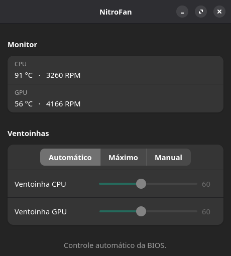

# NitroFan



A small GTK4 / libadwaita app to monitor temperatures and control the fan
speed on Acer Nitro laptops running Linux, a stand-in for Acer's Windows-only
NitroSense.

> **Status:** personal project, tested only on an **Acer Nitro AN517-54**
> (Manjaro, kernel 7.1, GNOME). Other Nitro models may work through the
> driver, but are untested.

## How it works

Acer's NitroSense talks to the firmware through the gaming WMI interface
(`7A4DDFE7-5B5D-40B4-8595-4408E0CC7F56`). The stock `acer_wmi` kernel module
doesn't expose it, so this project builds on
[Linuwu-Sense](https://github.com/0x7375646F/Linuwu-Sense), a patched
`acer_wmi` that does. The app only reads and writes sysfs files; it needs no
root once your user is in the `linuwu_sense` group.

## Features

- **Monitor** — CPU and GPU temperature and fan RPM, refreshed every 2 s.
- **Automatic** — hands control back to the firmware.
- **Maximum** — both fans at 100%.
- **Manual** — separate CPU and GPU sliders, 30–100%.

Safety nets: manual speed is limited to 30% or more, the app falls back to
automatic if CPU or GPU reaches 95 °C, and it returns to automatic when the
window closes.

## Requirements

- An Acer Nitro laptop with the gaming WMI interface
- Linux with kernel headers for your running kernel, `dkms`, `git`, `make`
- Python 3, PyGObject, GTK 4 and libadwaita
- `nvidia-smi` for the GPU temperature (optional)

## Installation

1. Install the kernel headers (Manjaro example):

   ```bash
   sudo pacman -S --needed linux71-headers dkms
   ```

2. Build and install the patched driver. This replaces `acer_wmi`, blacklists
   it, and adds your user to the `linuwu_sense` group:

   ```bash
   ./driver/install.sh
   ```

3. Log out and back in so the new group applies.
4. Install the menu entry and icon:

   ```bash
   ./scripts/install-app.sh
   ```

Or run it directly: `python3 app/nitrofan.py`

To remove the driver, run `make uninstall` inside `driver/build/`.

## Other Nitro models

`driver/0001-add-nitro-an517-54.patch` adds the AN517-54 to the driver's model
table, reusing the profile of the AN515-55. For another model, add an entry for
your `DMI_PRODUCT_NAME` (`cat /sys/class/dmi/id/product_name`) the same way.

## Fan control by hand

```bash
F=/sys/module/linuwu_sense/drivers/platform:acer-wmi/acer-wmi/nitro_sense/fan_speed
echo 70,70 > $F    # CPU%,GPU%
echo 0,0   > $F    # back to automatic
```

## Disclaimer

The driver talks to low-level WMI methods without any involvement from Acer.
Use it at your own risk. Never leave the fans low under heavy load.

## License

The app (`app/`) and scripts are [MIT](LICENSE).

The patch in `driver/` modifies [Linuwu-Sense](https://github.com/0x7375646F/Linuwu-Sense),
which derives from the Linux kernel's `acer-wmi`, so the patch is under
GPL-2.0-or-later. The driver is cloned at install time, not redistributed here.
The app only talks to it through sysfs and links GTK 4, libadwaita and PyGObject
(all LGPL-2.1+) dynamically.

This project is unofficial and not affiliated with Acer. NitroSense and Nitro
are trademarks of Acer Inc.; no Acer code or assets are included.
